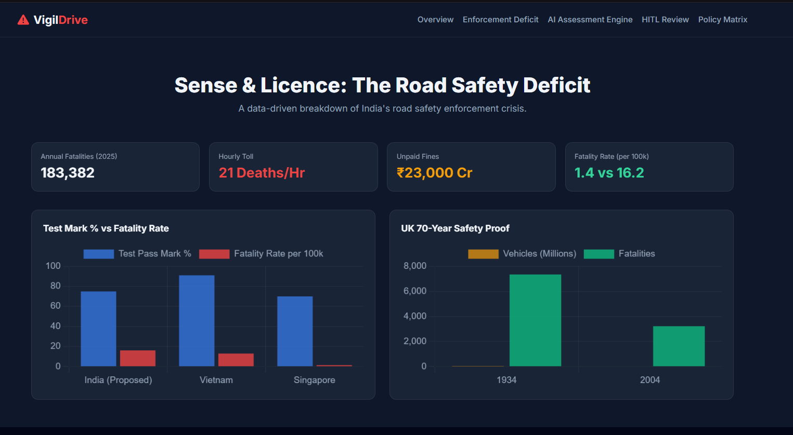
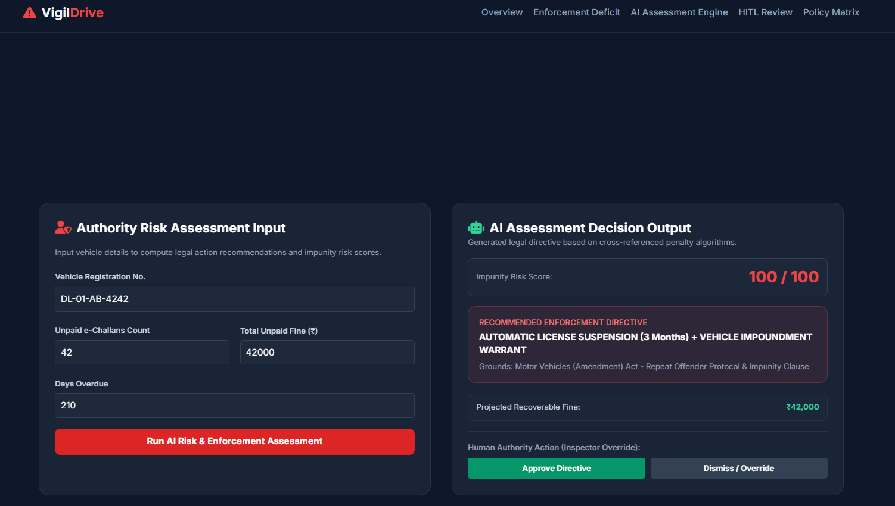
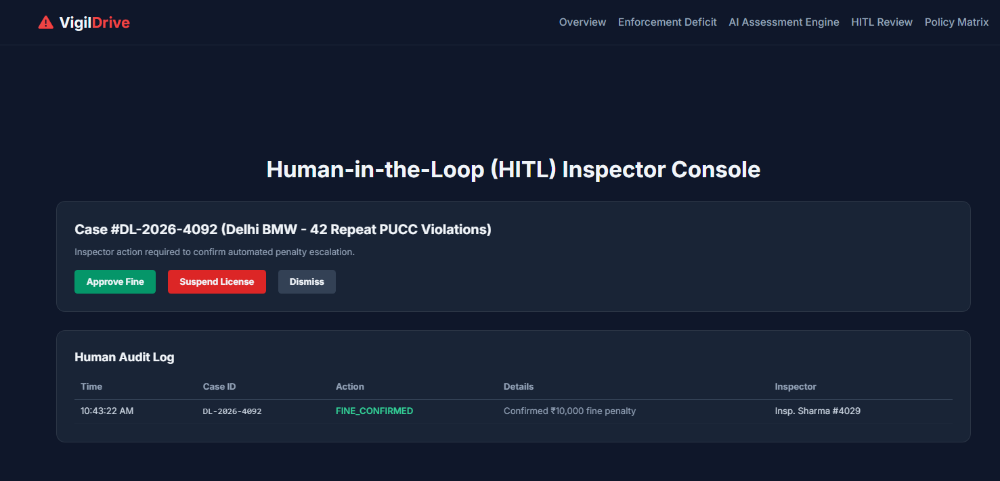
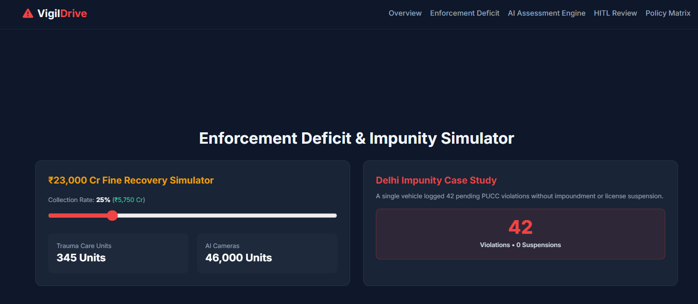
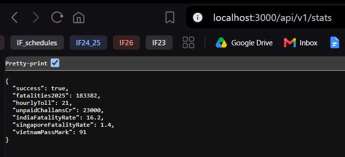
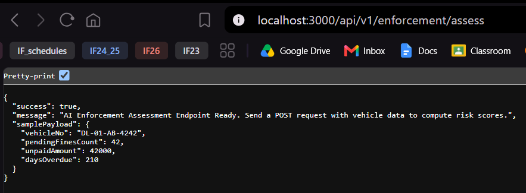

# **CSI 6007 Advanced AI Core Lab ISA2 Exam Answer Book** 

## **Problem statement**

India loses 183,382 lives annually (\~21 deaths/hour) to road accidents. Current policies over-index on driver testing while ignoring a ₹23,000 crore enforcement deficit and lacking automated, human-verified penalty escalation systems for repeated offenders.

## **Target audience**

Traffic enforcement authorities, urban policy experts, civic researchers, and citizens.

## **In scope today**

* Multi-Page Web Application: 5 routed pages (index.html, deficit.html, assess.html, hitl.html, policy.html).  
*  Visualizations: Chart.js graphs for global pass marks vs. fatalities and the 70-year UK safety trajectory.  
* Calculators: Dynamic ₹23,000 Cr Fine Recovery Simulator.  
* AI Enforcement Risk Engine: Automated assessment tool computing Impunity Risk Scores (0–100) and recommending legal directives.  
* Human-in-the-Loop (HITL) Console: Officer verification panel with audit logging workflow.  
*  Full-Stack REST Backend: Express.js server providing 5 endpoints (/api/v1/...).

## **Out of scope (deferred)**

Setting up external SQL/NoSQL cloud databases, physical camera hardware integration, live mobile app notifications, and LLM fine-tuning.

## **Success check**

Executable Node.js server (server.js) that serves 5 responsive views, processes POST API payloads for risk scoring and voting, logs HITL inspector actions, and maintains data integrity.

## **AI coding assistant**

Gemini / AI Coding Assistant: Rapid generation of backend API routes, Tailwind utility classes, mathematical risk score algorithms, and HITL UI components.

## **Design Principles:**

1. DRY: Shared navigation headers, CSS variables, and global Chart.js routines prevent code duplication across all 5 pages.   
2. Orthogonality: The frontend UI components (public/) are completely independent of the backend business logic (server.js). Modifying the risk assessment formula does not break the HTML view.  
3. Human In The Loop   
   * Concept: Automated AI models should not make irreversible penal decisions (e.g., impounding a car or suspending a driver's licence) without human oversight.  
   * Implementation: The AI Assessment Engine computes a risk score and recommends a directive, but routes the action to the HITL Review Console (hitl.html) where a human officer must verify, modify, or reject the order before it enters the official audit log.  
   * 

## **What is still not working, and what would you do next with more time?**

**Answer**: The Express server currently uses in-memory data structures (dbState), meaning logs reset if the server restarts. With more time I would connect Express to a PostgreSQL database using Prisma ORM and add OAuth2 officer authentication.

## **Screenshots of Outputs** 

Figure 1.1: VigilDrive Main Overview Dashboard displaying real-time metric cards and Chart.js cross-country comparative analytics. 

Figure 1.2: AI Enforcement Risk Assessment Engine executing threat scoring algorithms and outputting automated legal directives. 

Figure 1.3: Human-in-the-Loop (HITL) Inspector Console displaying officer verification workflows and persistent audit logging. 

Figure 1.4: Interactive ₹23,000 Cr e-challan recovery calculator translating collection rates into healthcare and enforcement infrastructure units. 

 | 
Figure 2.1: Express.js REST API backend serving structured JSON payloads for AI risk assessment and state persistence. 
